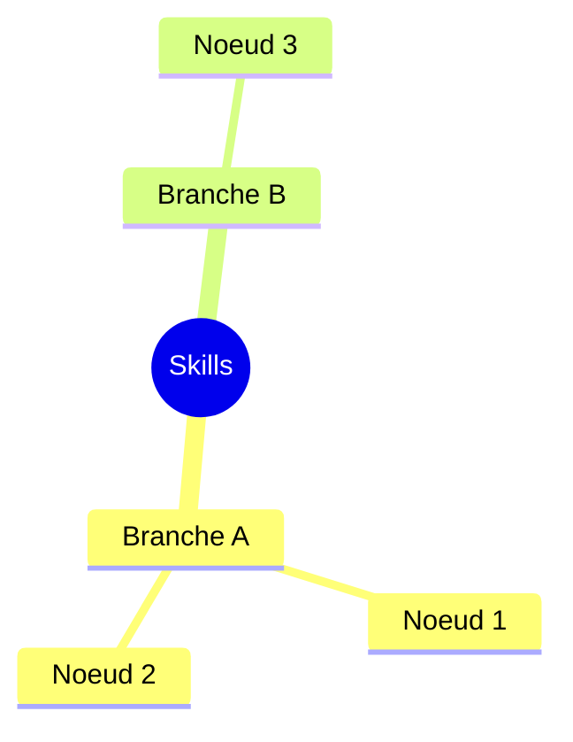

# Organisation des skills — carte associative en texte

Ce skill maintient une carte des skills/savoirs disponibles sous forme de
graphe en fichiers markdown plats : un tronc léger toujours consultable
(`INDEX.md`) et des noeuds détaillés chargés à la demande (`nodes/*.md`),
reliés entre eux par des liens `[[slug]]`.

Le principe : une vraie carte mentale *visuelle* n'apporte rien à Claude
(qui lit du texte linéairement) et coûte cher à maintenir sans outil de
dessin. Ce qui compte dans une mind map — regroupement thématique, liens
associatifs, vue d'ensemble rapide — s'obtient tout aussi bien avec un
index hiérarchique + des liens croisés en texte. Le rendu visuel (Mermaid)
reste une projection générée à la demande, jamais la source de vérité.

## Emplacement

Ce skill lit et écrit dans `skills-map/` à la racine du projet courant
(à créer au premier usage si absent) :

```
skills-map/
  INDEX.md              # le tronc : branches + une ligne par noeud
  nodes/
    <slug>.md            # un fichier par skill/savoir
```

## Format de INDEX.md

Reste court volontairement (c'est la seule partie systématiquement lue en
entier). Une section `##` par branche thématique, une ligne par noeud avec
lien relatif vers son fichier :

```markdown
# Carte des skills

## <Nom de branche>
- [<titre court>](nodes/<slug>.md) — <une ligne de description>
```

## Format d'un fichier noeud

```markdown
---
slug: <slug>
title: <titre>
branche: <nom de la branche dans INDEX.md>
lie_a: [<slug-associe-1>, <slug-associe-2>]
---

<Description du savoir/skill : ce qu'il couvre, quand l'utiliser.>

**Quand l'utiliser** : <déclencheur concret>.
**Voir aussi** : [[<slug-associe-1>]], [[<slug-associe-2>]].
```

## Procédure

### 1. Ajouter un skill/savoir à la carte
1. Vérifier dans `INDEX.md` qu'un noeud équivalent n'existe pas déjà (si
   proche d'un noeud existant, préférer l'enrichir plutôt que dupliquer).
2. Créer `skills-map/nodes/<slug>.md` avec le frontmatter ci-dessus.
3. Ajouter une ligne dans `INDEX.md`, sous la branche existante la plus
   pertinente, ou créer une nouvelle branche si aucune ne convient.
4. Relire les noeuds voisins probables (même branche, thème proche) et
   ajouter les liens réciproques dans leur `lie_a` respectif.

### 2. Retrouver le bon skill pour une tâche
1. Lire `INDEX.md` en entier (il est conçu pour rester petit).
2. Identifier la ou les branches pertinentes, ouvrir les noeuds
   correspondants avec Read.
3. Suivre les `lie_a` d'un noeud si sa description ne suffit pas.

### 3. Fusionner des noeuds qui se recouvrent
Si deux noeuds couvrent le même besoin à plus de 70%, fusionner leur
contenu dans un seul fichier, mettre à jour tous les `lie_a` qui
pointaient vers le noeud supprimé, et retirer sa ligne de `INDEX.md`.

### 4. Élagage périodique
Sur demande de l'utilisateur (ou périodiquement) : relire `INDEX.md` et
chaque noeud, repérer doublons et entrées obsolètes, proposer les fusions/
suppressions avant de les appliquer.

### 5. Générer une vue mind-map (optionnel)
Sur demande explicite d'une visualisation : lire `INDEX.md` + les `lie_a`
des noeuds pertinents, puis générer un bloc Mermaid (`mindmap` pour une
vue par branches, ou `graph TD` pour mettre en avant les liens croisés).
Ce rendu est jetable — il n'est jamais réécrit dans `skills-map/`.

Exemple de sortie :



## Vue graphique (Minder) — conversion bidirectionnelle

Pour obtenir une vue graphique d'un skill/savoir (mind map éditable dans
[Minder](https://github.com/phase1geo/minder)), ou inversement récupérer
en texte le contenu d'une carte `.minder` existante, deux scripts Python
(bibliothèque standard uniquement, aucune dépendance) sont fournis dans
`scripts/`.

### Convention markdown ↔ mind map

```markdown
# Titre de la carte
> note de la racine (optionnelle)

- Branche
  - Sous-branche
    - Feuille
    > note de cette feuille (optionnelle)
```

- `# Titre` → noeud racine (plusieurs `# ` dans un même fichier = plusieurs
  cartes indépendantes, une par section).
- puce indentée par tranches de 2 espaces → hiérarchie des branches.
- `> texte` juste après une ligne (titre ou puce) → note attachée à ce
  noeud (`nodenote` côté Minder).

### markdown → .minder

```bash
python3 scripts/md_to_minder.py entree.md sortie.minder
```

La hiérarchie et les notes sont préservées fidèlement. La position des
noeuds (posx/posy) est calculée par une disposition simple ; si
l'agencement visuel n'est pas idéal à l'ouverture dans Minder, réorganiser
les noeuds à la souris — le contenu, lui, est complet et correct.

### .minder → markdown

```bash
python3 scripts/minder_to_md.py entree.minder sortie.md
```

Sans nom de fichier de sortie, les deux scripts écrivent sur stdout.

Round-trip testé et validé : `minder → md → minder → md` reproduit un
markdown strictement identique.

## Ce que ce skill ne fait pas

- Il ne remplace pas la mémoire persistante `user`/`feedback`/`project`
  décrite ailleurs : celle-ci reste dédiée au contexte utilisateur/projet,
  `skills-map/` est dédié à la cartographie des savoirs/skills eux-mêmes.
- Il ne stocke aucun rendu graphique : uniquement du texte + un diagramme
  Mermaid généré à la volée quand demandé.
